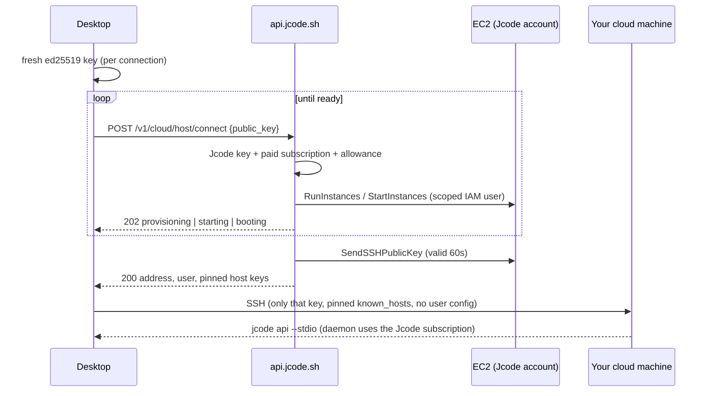

# Managed Jcode Cloud destination

## Contract

The Desktop Cloud button means Jcode-operated infrastructure authorized by the
user's Jcode account and subscription. It never means a personal AWS profile,
local `aws login`, a configured SSH alias, or the personal `jcode-cloud-alpha`
helper. Legacy `jcode-cloud-alpha` defaults and drafts migrate to the managed
destination and never run the personal helper.

## Registered machines on a self-hosted control plane

Machines shows the account's registered machines under **Jcode Cloud**, with the
account default and last-seen time. **Connect** starts a new session. **Sessions**
lists existing sessions to open. **Set default** changes where Desktop starts new
sessions, not the account's default machine or any existing panel.

A named default is saved as `default_remote_host = "cloud:ai-core"`. A panel from
that machine keeps `cloud://ai-core/<session-id>` in its snapshot, so it reconnects
by name even if the account default changes. `ssh://jcode-cloud/<session-id>` still
uses the account default. `ssh://ai-core/<session-id>` still uses ordinary SSH.

Desktop gets the registry from `GET /v1/cloud/hosts` and requests a named grant
with `POST /v1/cloud/host/connect` and `host: "ai-core"`. A named response must
confirm that exact self-hosted machine. Desktop connects to the returned IP and
pins the returned keys. It never passes a registry name to SSH. Each destination
has its own SSH master and prepared connection. Self-hosted machines keep their
own logins, model defaults and home directory.

If the registry endpoint returns 404 or 501, Desktop shows the single Cloud row
and uses the original unnamed connect request for it.

To verify a registered machine without running inference or creating a session,
load your account environment and run:

```sh
JCODE_CLOUD_TEST_HOST=ai-core justrust test -p jcode-desktop-harness \
  managed_cloud_live_named_machine_lists_sessions -- --ignored --nocapture
```

The offline fixture is `python3 scripts/screenshot.py target/cloudpick.png --cloud-picker`.

## How hosted Cloud works



- **Backend**: `solosystems-backend/workers/api/src/cloud_hosts.js`, routes
  `GET /v1/cloud/host`, `POST /v1/cloud/host/connect`, `POST /v1/cloud/host/stop`.
  `/v1/me` reports `capabilities.cloud_hosts`.
- **Infrastructure**: `solosystems-backend/infra/jcode-cloud/managed-hosts.yaml`
  (stack `jcode-cloud-production-hosts`, us-east-1). The worker's IAM user can
  launch only from the managed launch template and can only start, stop,
  terminate, read the console of, or push keys to `jcode:managed` instances.
- **Hosted isolation**: one machine per account, tagged `jcode:account`. Ownership is
  rechecked against EC2 tags on every request, and a mismatch fails closed.
- **Host keys**: printed to the serial console at first boot, captured and pinned
  by the control plane before any client is authorized.
- **Inference**: the machine gets its own revocable Jcode account key. The daemon
  runs `jcode --provider jcode serve`, so turns bill to the subscription. The
  key is revoked when the machine is replaced.
- **Lifecycle**: sleeps (stop, disk kept) after 30 minutes with no SSH client.
  Runtime accrues against a monthly allowance (default 50 hours), enforced by
  the connect path and a 5-minute cron. A failed first boot is terminated and
  replaced automatically.
- **Desktop**: `crates/jcode-desktop-ui/src/managed_cloud.rs`. The pending panel
  shows a live checklist: Jcode account, Cloud machine, Jcode installed, Secure
  connection, Jcode session. Failures keep the draft and queued prompts and offer
  Retry, Jcode account, and Use this computer. There is no implicit local fallback.

## Verification (2026-09-24)

- Fresh provision to first reply: about 100 seconds. Cold wake: about 46 seconds.
  Warm: about 4 seconds to a session, 5.5 seconds to a reply.
- The live Desktop test ran with `HOME` holding only the Jcode account file and
  AWS configuration pointed at `/dev/null`:
  `cargo test -p jcode-desktop-ui managed_cloud_live -- --ignored --nocapture`.
- Backend: `npm test` in `workers/api` (fake EC2, real SQLite), covering
  entitlement denial, cross-account isolation, allowance exhaustion, host-key
  pinning, failed boots, and key revocation.

## Self-hosted control plane

When `JCODE_API_BASE` points at a self-hosted backend (xenking/jcode-cloud), the
Cloud destination reaches a machine the account registered there, not an EC2
host. The connect reply carries `self_hosted: true`. Desktop then skips the
model and login sync, because that machine's daemon is shared with other
clients and keeps its own logins, and it starts sessions in the login's home
directory, because the bootstrap workspace does not exist there. Key
authorization, host-key pinning and the SSH transport are unchanged.

Checked on 2026-11-21 against ai-core:
`justrust test -p jcode-desktop-harness managed_cloud_live_session_answers_a_prompt -- --ignored --nocapture`
created a session in 0.6 s and received the reply in 3.5 s.

## Known limits

- One region (us-east-1) and one instance type (m7i.large).
- The pinned Jcode release (`CLOUD_JCODE_VERSION`) is installed at first boot.
  Existing machines are not upgraded automatically.
- Model credentials other than the Jcode subscription are not synchronized.
